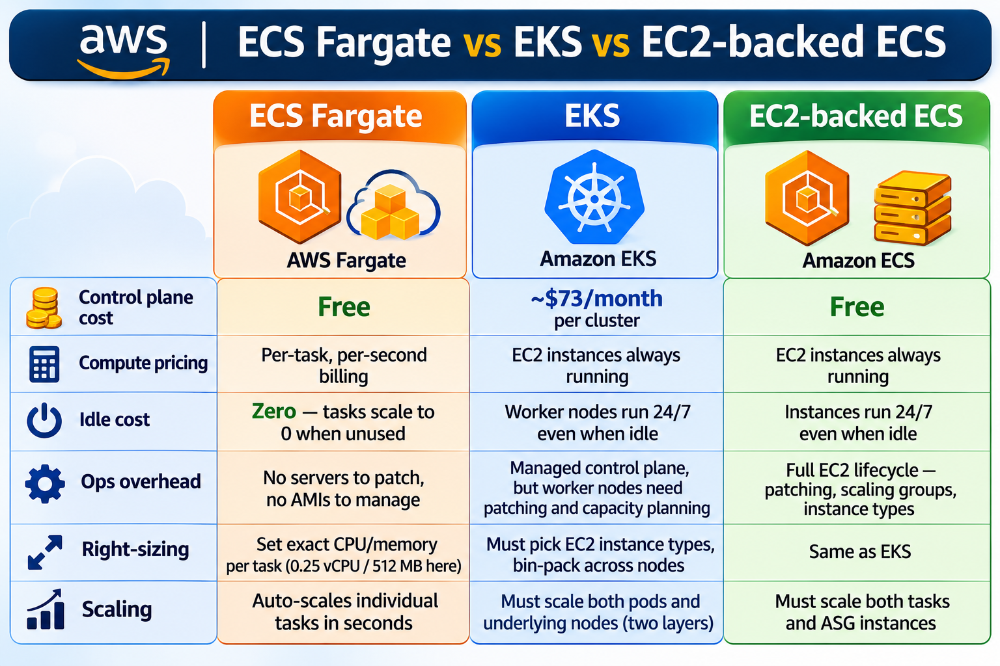

# Demo Application

A containerized full-stack web application deployed on AWS ECS Fargate with CI/CD pipelines, vulnerability scanning, and auto-scaling — authenticated via GitHub OIDC with no static credentials.

## SPARK — Security Principles

| | Principle | What it means |
|:-:|---|---|
| **S** | **Security** | GitHub OIDC federated authentication — no passwords, no keys in pipelines |
| **P** | **Protection** | Zero long-lived credentials; short-lived tokens with least-privilege IAM roles |
| **A** | **Availability** | Multi-AZ deployment across private subnets with auto-scaling and health checks |
| **R** | **Recovery** | 100% Infrastructure-as-Code (Terraform) — tear down and recreate in minutes |
| **K** | **Knowledge** | CloudWatch Logs for application telemetry, CloudTrail for API audit trail |

## Why ECS Fargate — Cost Optimization



**Cost breakdown for this application:**
- Each Fargate task (0.25 vCPU, 512 MB) costs ~$0.012/hour in us-east-1
- With 2 tasks running (frontend + backend), that's ~$17/month
- Auto-scaling to 0 during off-hours can reduce this further
- No EKS control plane fee saves $73/month vs. an equivalent EKS setup
- No idle EC2 capacity saves the cost of running instances when traffic is low

**When ECS Fargate is the right choice:**
- Workloads with variable or unpredictable traffic (pay only for what you use)
- Small-to-medium services where Kubernetes features aren't needed
- Teams that want to focus on application code, not infrastructure management
- Cost-sensitive environments where idle compute is waste

## Architecture

```
Internet → ALB (HTTPS/443) → Frontend (Nginx, port 80) → /api/* proxy → Internal ALB (HTTP/80) → Backend (Express, port 3000)
```

- **Frontend**: Nginx serving static HTML/CSS/JS, proxying `/api/` to the backend via the internal ALB (`BACKEND_URL` env var injected at container startup)
- **Backend**: Node.js/Express REST API with application endpoints and stress test endpoints for auto-scaling demos

```
application-repo/
├── frontend/
│   ├── index.html              # Main application page
│   ├── style.css               # Styling
│   ├── script.js               # Frontend logic (API calls, load test monitor)
│   ├── nginx.conf              # Nginx reverse proxy template (uses $BACKEND_URL)
│   ├── entrypoint.sh           # Substitutes env vars into nginx config at startup
│   ├── Dockerfile              # nginx:alpine based image
│   └── .dockerignore
├── backend/
│   ├── index.js                # Express server with API and stress test endpoints
│   ├── package.json            # Node.js dependencies
│   ├── Dockerfile              # node:18-alpine based image
│   └── .dockerignore
└── .github/
    └── workflows/
        ├── ci-reusable.yml     # Reusable CI: build, push, Trivy scan (platform-owned)
        ├── ci.yml              # CI caller: passes parameters to reusable workflow
        └── deploy.yml          # CD: verify CI, approve, deploy (main)
```

## CI/CD Pipelines

### CI Pipeline (`ci.yml` → `ci-reusable.yml`) — Feature branches only

The CI pipeline uses a **reusable workflow** (`ci-reusable.yml`) owned by the platform team. Application teams own the caller (`ci.yml`) that passes parameters and can add extra jobs before or after the reusable workflow — but cannot modify the build/scan logic or runners inside it.

| Step | Commit Status | Description |
|------|---------------|-------------|
| Build frontend | `ci/frontend-build` | Builds and pushes image tagged `frontend-<commit-sha>` to ECR |
| Build backend | `ci/backend-build` | Builds and pushes image tagged `backend-<commit-sha>` to ECR |
| Trivy scan | `ci/trivy-scan` | Scans images with Trivy for CRITICAL/HIGH vulnerabilities; warns with a 7-day remediation window but does not block |

Images are tagged with the full commit SHA for immutability — no `:latest` tags in CI. Trivy replaces ECR Basic scanning for faster, more detailed results.

### CD Pipeline (`deploy.yml`) — Main branch only

Does **not** rebuild images. Pulls CI-built images by their immutable commit-SHA tag.

| Step | Commit Status | Description |
|------|---------------|-------------|
| Verify CI | `cd/verify-ci` | Checks that all three CI statuses passed on this commit |
| Approval | `cd/approval` | Waits for manual approval via the `production` GitHub environment |
| Deploy | `cd/deploy-ecs` | Registers new ECS task definitions pointing to `<service>-<commit-sha>` images and updates services |

### Setup

- **Secret**: `AWS_ROLE_ARN` — IAM role ARN configured for GitHub OIDC (from the infra repo's `bootstrap/` stack)
- **Environment**: Create `production` in repo Settings > Environments with required reviewers

## API Endpoints

| Method | Endpoint             | Description |
|--------|----------------------|-------------|
| GET    | `/api/health`        | Health check with uptime and timestamp |
| POST   | `/api/greet`         | Greeting in 6 languages |
| POST   | `/api/calculate`     | Calculator (add, subtract, multiply, divide) |
| POST   | `/api/text`          | Text tools (uppercase, lowercase, title case, reverse, word/char count) |
| GET    | `/api/info`          | Container info (hostname, platform, memory, CPUs) |
| POST   | `/api/stress`        | Start CPU or memory stress test (5–300s) |
| GET    | `/api/stress/status` | Live resource usage and stress test state |

## Auto-Scaling

ECS auto-scaling is configured with target tracking policies on both CPU and memory utilization. The thresholds are configurable in Terraform (`scaling_cpu_threshold` / `scaling_memory_threshold`, default 50%).

The built-in stress test triggers scaling during demos:
- **CPU stress**: Spawns worker threads with tight compute loops. The main thread stays responsive for health checks.
- **Memory stress**: Allocates 300 MB (~74% of the 512 MB task limit), exceeding the 50% threshold.
- **Scaling behavior**: CloudWatch evaluates metrics over ~3 minutes of sustained load before adding tasks. Scale-in has a cooldown to prevent flapping.

The frontend includes a live resource monitor that polls every 2s during a test, showing memory meters and the responding hostname — useful for observing new tasks coming online.

## Infrastructure

This application depends on the ECS infrastructure from the companion repository:
[platform_infra_aws](https://github.com/PLT-AME-CLOUD/platform_infra_aws)

That repo provisions via Terraform:
- VPC, subnets, security groups, and VPC endpoints (ECR, S3, CloudWatch Logs)
- ECS Fargate cluster, ECR repository (scan-on-push enabled)
- Public and internal ALBs with target groups and health checks
- Auto-scaling policies, IAM roles, ACM certificate, Route 53 DNS

## Local Development

```bash
# Backend only
cd backend && npm install && npm start
# Available at http://localhost:3000

# Full stack with Docker
cd backend
docker build -t test-backend .
docker run -d -p 3000:3000 --name backend test-backend

cd ../frontend
docker build -t test-frontend .
docker run -d -p 8080:80 -e BACKEND_URL=http://host.docker.internal:3000 --name frontend test-frontend
# Visit http://localhost:8080

# Clean up
docker stop frontend backend && docker rm frontend backend
```

## Troubleshooting

| Issue | Check |
|-------|-------|
| Frontend can't reach backend | Verify `BACKEND_URL` env var is set in the ECS task definition; check security groups allow port 3000 from internal ALB |
| OIDC role assumption fails | Confirm `application-repo` is in the bootstrap trust policy (`github_repos`); wildcards must handle `@<id>` suffixes in GitHub's OIDC sub claim |
| CD says "CI checks not satisfied" | CI runs on feature branches only — push there first, then merge to main |
| ECR scan not running | Use `--provenance=false` on `docker build` to produce Docker V2 manifests (Basic scanning can't process OCI format) |
| Container OOM killed (SIGKILL) | Memory stress allocates 300 MB; with Node.js overhead (~70 MB) this stays under the 512 MB limit. Keep total RSS below 450 MB |
| Health check failing | Backend must return 200 on `GET /api/health`; frontend must return 200 on `GET /` |
| Auto-scaling not triggering | Scaling needs sustained load above the threshold for ~3 minutes; check CloudWatch metrics `ECSServiceAverageCPUUtilization` / `ECSServiceAverageMemoryUtilization` |
